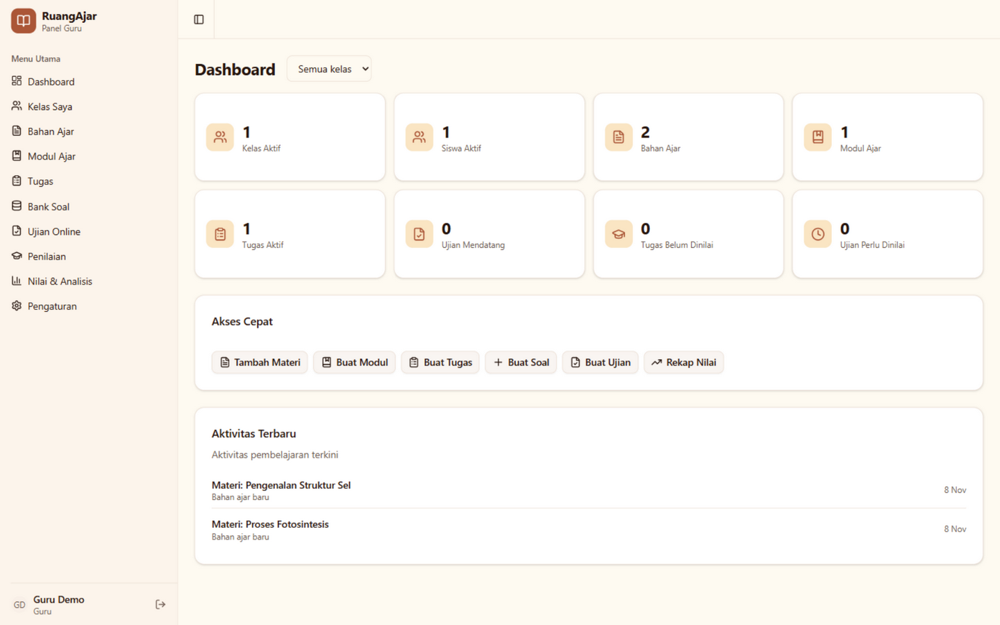
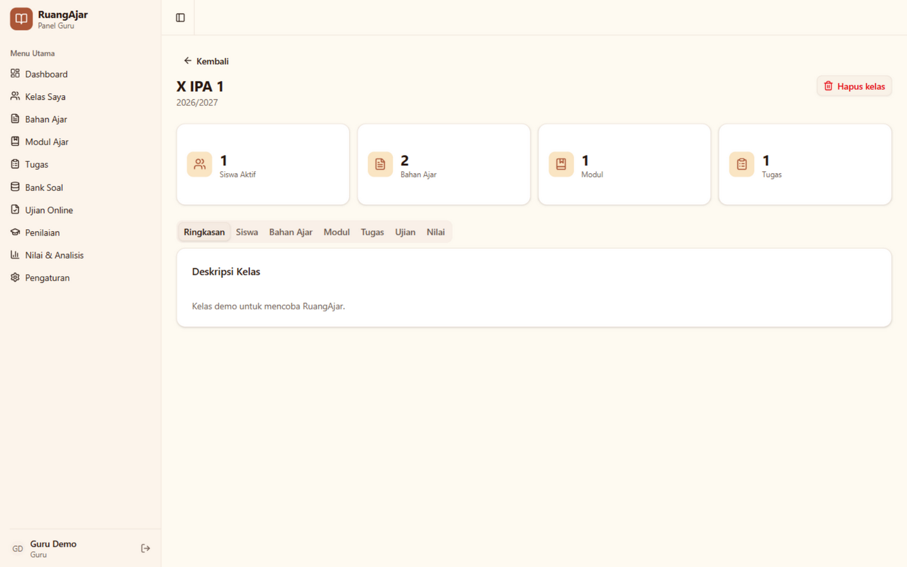
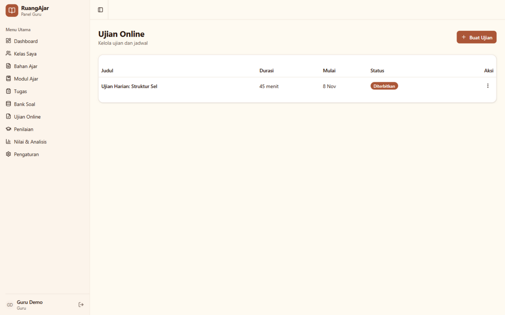
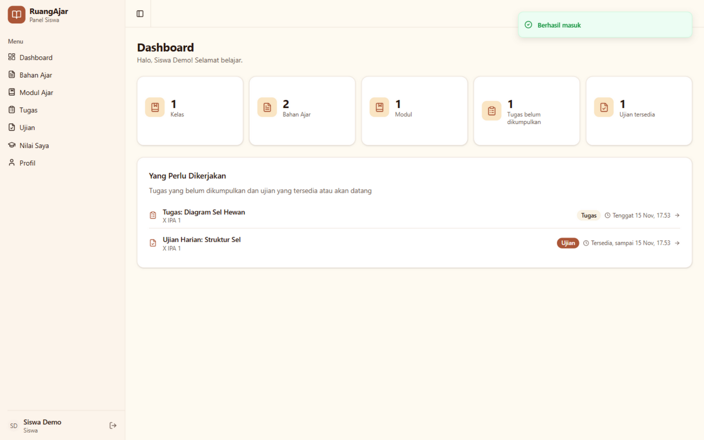
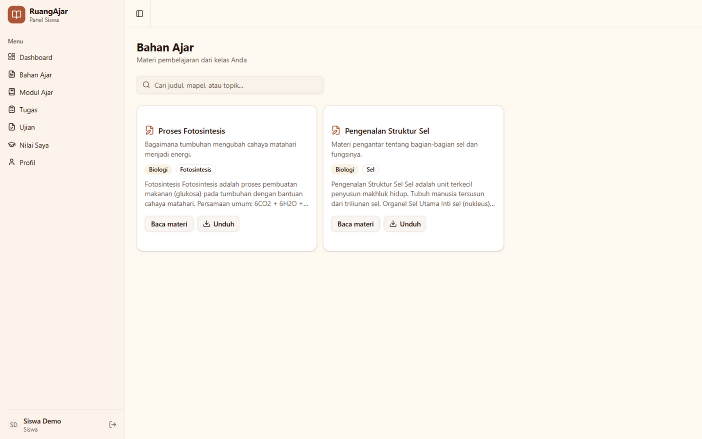
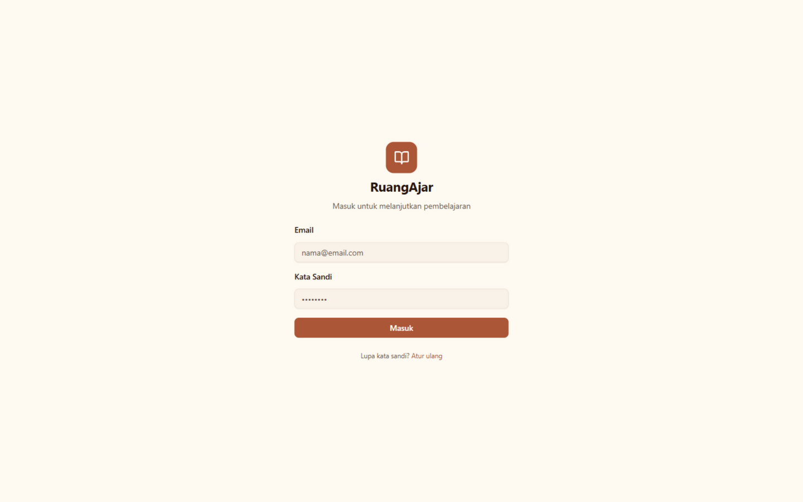
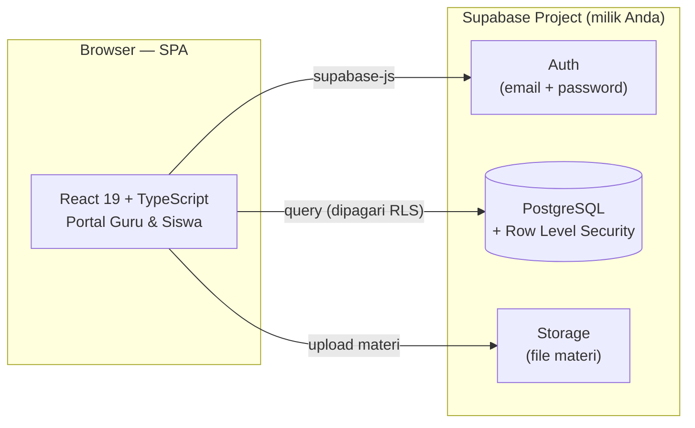

<p align="center">
  
</p>

<h1 align="center">RuangAjar</h1>

<p align="center">
  <strong>Learning Management System (LMS) untuk guru & siswa</strong><br>
  Kelola kelas, materi, modul, tugas, bank soal, ujian, penilaian, dan analitik — dalam satu aplikasi.
</p>

<p align="center">
  <a href="https://github.com/zann06/LMS/actions/workflows/deploy.yml"></a>
  <a href="LICENSE"></a>
  <a href="https://react.dev"></a>
  <a href="https://vite.dev"></a>
  <a href="https://supabase.com"></a>
  <a href="CONTRIBUTING.md"></a>
</p>

<p align="center">
  🌐 <a href="https://zann06.github.io/LMS/"><strong>Live Demo</strong></a>
  · 🐛 <a href="https://github.com/zann06/LMS/issues">Laporkan Bug</a>
  · 💡 <a href="https://github.com/zann06/LMS/issues">Usulkan Fitur</a>
</p>

---

> 🇮🇩 Dokumen ini ditulis dalam Bahasa Indonesia.

## Daftar Isi

- [Demo](#demo)
- [Fitur](#fitur)
- [Tampilan](#tampilan)
- [Teknologi](#teknologi)
- [Arsitektur](#arsitektur)
- [Mulai Cepat](#mulai-cepat)
- [Setup Database Supabase](#setup-database-supabase)
- [Deploy ke GitHub Pages](#deploy-ke-github-pages)
- [Menjalankan di Komputer Lokal](#menjalankan-di-komputer-lokal)
- [Struktur Proyek](#struktur-proyek)
- [Rute Aplikasi](#rute-aplikasi)
- [Skrip npm](#skrip-npm)
- [Keamanan](#keamanan)
- [Troubleshooting](#troubleshooting)
- [Roadmap](#roadmap)
- [FAQ](#faq)
- [Kontribusi](#kontribusi)
- [Lisensi](#lisensi)
- [Kredit](#kredit)

---

## Demo

🌐 **Aplikasi live:** <https://zann06.github.io/LMS/>

**Coba sebagai siswa** (akun demo publik):

```
Email    : siswa@demo.local
Password : SiswaDemo2026!
```

Dengan akun siswa kamu bisa melihat kelas "X IPA 1", membaca 2 materi bahan ajar, melihat tugas dengan tenggat, dan mengerjakan ujian pilihan ganda (3 soal, timer 45 menit, skor langsung muncul setelah submit).

> **Catatan demo:** data di instance live adalah data contoh — pengunjung demo bisa mengubahnya. Untuk pemakaian nyata, selalu deploy dengan project Supabase milik Anda sendiri (ikuti [Mulai Cepat](#mulai-cepat), ±10 menit). Akun guru **tidak** dipublikasikan — guru mengelola kelas, materi, bank soal, ujian, penilaian, dan analitik pada instance masing-masing.

---

## Fitur

### 👨‍🏫 Portal Guru

| Fitur | Detail |
|---|---|
| **Dashboard** | Ringkasan kelas, tugas, dan ujian yang sedang berjalan |
| **Kelas** | Buat kelas, undang/tambah siswa via email (akun dibuat otomatis), detail per kelas |
| **Materi** | Unggah & kelola materi pembelajaran, ekspor ke PDF |
| **Modul** | Susun modul pembelajaran terstruktur, ekspor PDF/PPTX |
| **Tugas** | Buat tugas, terima submission, nilai & umpan balik |
| **Bank Soal** | Kumpulan soal yang bisa dipakai ulang di banyak ujian, ekspor dokumen soal |
| **Ujian** | Buat ujian dari bank soal, atur timing & aturan attempt, publish nilai |
| **Penilaian** | Nilai submission siswa dari satu layar |
| **Analitik** | Grafik performa kelas (Recharts) |
| **Pengaturan** | Kelola akun guru |

### 🎓 Portal Siswa

| Fitur | Detail |
|---|---|
| **Dashboard** | Ringkasan tugas & ujian mendatang |
| **Materi & Modul** | Baca materi dari guru |
| **Tugas** | Kerjakan & kirim tugas, lihat nilai |
| **Ujian** | Ujian dengan aturan attempt & timer, layar pengerjaan khusus layar penuh |
| **Nilai** | Rekap nilai tugas & ujian |
| **Profil** | Data akun siswa |

### ⚙️ Umum

- 🔐 Autentikasi Supabase (email + kata sandi, lupa password)
- 🛡️ Route protection berbasis role (`teacher` / `student`) + **Row Level Security** di database
- 🌗 Mode gelap / terang
- 📱 Responsif — bisa dipakai dari ponsel
- 📤 Ekspor dokumen: PDF (jsPDF) & PPTX (pptxgenjs), CSV untuk data nilai
- 🇮🇩 Antarmuka Bahasa Indonesia

---

## Tampilan

| Portal Guru | |
|:---:|:---:|
| **Dashboard Guru** — ringkasan kelas, tugas & aktivitas | **Detail Kelas** — siswa, materi, modul, tugas, ujian |
|  |  |
| **Ujian Online** — buat ujian dari bank soal, atur timer & attempt | |
|  | |

| Portal Siswa | |
|:---:|:---:|
| **Dashboard Siswa** — tugas & ujian yang perlu dikerjakan | **Bahan Ajar** — baca & unduh materi dari guru |
|  |  |

| Halaman Masuk | |
|:---:|:---:|
| **Login** — portal guru & siswa dalam satu pintu | |
|  | |

---

## Teknologi

| Layer | Teknologi |
|---|---|
| Framework | [React 19](https://react.dev) + [React Router 7](https://reactrouter.com) |
| Bahasa | TypeScript 5.9 (strict) |
| Build | [Vite 7](https://vite.dev) |
| Styling | [Tailwind CSS 4](https://tailwindcss.com) + [shadcn/ui](https://ui.shadcn.com) (Radix UI) |
| Backend | [Supabase](https://supabase.com) — PostgreSQL, Auth, Storage, RLS |
| Grafik | Recharts 3 |
| Dokumen | jsPDF 4, pptxgenjs 4, html2canvas |
| Lainnya | lucide-react, sonner, next-themes |

---

## Arsitektur

SPA statis (bisa di-host di GitHub Pages / Vercel / Netlify / hosting statis mana pun) yang berbicara langsung ke project Supabase Anda:



Poin penting:

- **Tidak ada server aplikasi.** Semua logika akses data dipagari di database oleh **Row Level Security (RLS)** — policy-nya ada di `supabase/migrations/`.
- **Anon key memang untuk publik.** Yang menentukan siapa boleh melihat data adalah RLS, bukan kerahasiaan key frontend.
- Role pengguna (`teacher`/`student`) di-set otomatis oleh trigger `handle_new_user()` saat pendaftaran.

---

## Mulai Cepat

Prasyarat:

- **Node.js** 20.19+ / 22.12+ — cek dengan `node -v`
- **npm** 10+
- Akun [Supabase](https://supabase.com) gratis

### 1. Clone & install

```bash
git clone https://github.com/zann06/LMS.git
cd LMS
npm install
```

### 2. Buat project Supabase

1. Buka <https://supabase.com/dashboard> → **New project**
2. Simpan password database (tidak dipakai aplikasi, tapi wajib disimpan)
3. Tunggu sampai project aktif

### 3. Jalankan migration SQL

Ikuti [Setup Database Supabase](#setup-database-supabase).

### 4. Konfigurasi kredensial

**Cara A — file `.env` (untuk development lokal):**

```bash
cp .env.example .env
```

Isi `.env` (nilainya dari **Supabase Dashboard → Project Settings → API**):

```env
VITE_SUPABASE_URL=https://<project-ref>.supabase.co
VITE_SUPABASE_ANON_KEY=<anon-key>
```

**Cara B — file `public/config.js` (untuk deploy GitHub Pages):**

Edit `public/config.js` — file ini dibaca saat runtime, tanpa perlu build ulang:

```js
window.RUANGAJAR_CONFIG = {
  supabaseUrl: 'https://<project-ref>.supabase.co',
  supabaseAnonKey: '<anon-key>',
}
```

> Kedua cara boleh dipakai bersamaan; nilai di `config.js` (runtime) menang atas `.env` (build-time). Placeholder yang belum diedit otomatis dianggap kosong.

> ⚠️ **Hanya anon / public key.** `service_role` key melewati RLS dan tidak boleh pernah ada di kode frontend.

### 5. Jalankan

```bash
npm run dev
```

Buka <http://localhost:5173>. Buat akun guru pertama (lihat [Setup Database](#setup-database-supabase)), lalu buat siswa dari menu **Kelas**.

---

## Setup Database Supabase

Schema database ada di `supabase/migrations/`.

### Cara A — Supabase SQL Editor (paling mudah)

Buka **SQL Editor → New query**, salin seluruh isi **`supabase/setup.sql`**, lalu **Run**. Satu file berisi semua migration dalam urutan yang benar (schema, RLS, trigger, kunci jawaban, fitur guru) dan aman dijalankan ulang.

> Preferensi per-file? Jalankan 4 file di `supabase/migrations/` secara berurutan: `20261006144215_001_initial_schema.sql` → `20261007074229_repair_auth_profile_trigger.sql` → `20261007080001_private_answer_keys.sql` → `002_teacher_tools.sql`.

### Cara B — Supabase CLI

```bash
npm install -g supabase   # atau: brew install supabase/tap/supabase
supabase login
supabase link --project-ref <project-ref>
supabase db push
```

### Membuat akun guru pertama

Dua migration menyediakan pembuatan akun demo `guru@ruangajar.com`. **Password tidak disimpan di repo** — migration membacanya dari session variable dan **dilewati (no-op)** bila variable belum di-set.

Jalankan di SQL Editor, **dalam satu sesi/koneksi**:

```sql
SET app.demo_teacher_password = 'password-anda-yang-kuat';
```

lalu jalankan salah satu:

- `supabase/migrations/20261007073725_create_test_teacher_account.sql`
- `supabase/migrations/20261007074029_repair_test_teacher_auth_account.sql`

> ⚠️ Jangan pakai akun demo di project produksi, dan jangan pernah commit password asli. Untuk pemakaian nyata, buat akun guru via Supabase Dashboard (**Authentication → Add user**) lalu pastikan row `profiles.role` bernilai `teacher`.

### Konfigurasi Auth (untuk deploy)

Supaya fitur **lupa password** bekerja di domain deploy Anda:

1. **Supabase Dashboard → Authentication → URL Configuration**
2. **Site URL** → URL aplikasi Anda (mis. `https://zann06.github.io/LMS/`)
3. **Redirect URLs** → tambahkan `https://zann06.github.io/LMS/**` (atau domain Anda sendiri)

---

## Deploy ke GitHub Pages

Repo ini dilengkapi workflow [`.github/workflows/deploy.yml`](.github/workflows/deploy.yml) yang build & deploy otomatis ke GitHub Pages setiap push ke `main`.

### Opsi 1 — Fork → hidupkan Pages (paling mudah)

1. **Fork** repo ini ke akun GitHub Anda.
2. Isi kredensial Supabase dengan **salah satu** cara:
   - Edit `public/config.js` di fork Anda dan commit, **atau**
   - **Settings → Secrets and variables → Actions → New repository secret**, tambahkan:
     | Name | Value |
     |---|---|
     | `VITE_SUPABASE_URL` | URL project Supabase Anda |
     | `VITE_SUPABASE_ANON_KEY` | anon key Anda |
3. **Settings → Pages → Build and deployment → Source** → pilih **GitHub Actions**.
4. Push ke `main` (atau klik **Run workflow** di tab Actions). Selesai — situs live di
   `https://<username-anda>.github.io/<nama-repo>/`.

### Opsi 2 — Repo sendiri

Sama seperti Opsi 1, tapi clone/fork lalu push ke repo milik Anda. Workflow otomatis mendeteksi nama repo dan membangun dengan base path `/<nama-repo>/`.

### Deploy manual / hosting lain

```bash
npm run build:pages        # build dengan base /<nama-repo>/ (untuk GitHub Pages)
# atau: npm run build      # base "/" — untuk Vercel/Netlify/hosting root lain
cp dist/index.html dist/404.html   # fallback SPA khusus GitHub Pages
```

Upload isi `dist/` ke hosting statis mana pun. Untuk hosting dengan SPA fallback bawaan (Vercel, Netlify, Cloudflare Pages), langkah `404.html` tidak diperlukan.

> ℹ️ Kenapa perlu `404.html`? GitHub Pages hanya menyajikan file statis; URL dalam seperti `/LMS/login` tidak menemukan file. Dengan menyalin `index.html` sebagai `404.html`, GitHub menyajikan aplikasi di URL mana pun dan React Router membaca path aslinya.

---

## Menjalankan di Komputer Lokal

| Perintah | Fungsi |
|---|---|
| `npm run dev` | Dev server + HMR di <http://localhost:5173> |
| `npm run build` | Type-check + build produksi ke `dist/` (base `/`) |
| `npm run build:pages` | Build produksi dengan base `/<nama-repo>/` (GitHub Pages) |
| `npm run preview` | Preview hasil build |
| `npm run typecheck` | Cek TypeScript saja |

Setelah mengubah `.env`, restart dev server — environment Vite hanya dimuat saat start.

---

## Struktur Proyek

```
.
├── public/
│   ├── fonts/               # DejaVu Sans (PDF unicode) + lisensinya
│   ├── config.js            # Konfigurasi runtime (Supabase URL & anon key)
│   └── favicon.svg
├── src/
│   ├── components/
│   │   ├── ui/              # Komponen shadcn/ui (hanya yang terpakai)
│   │   ├── protected-route.tsx
│   │   ├── teacher-layout.tsx / student-layout.tsx
│   │   └── ...              # dialog, sidebar, export menu, rich text
│   ├── contexts/
│   │   └── auth-context.tsx # State autentikasi & role
│   ├── hooks/
│   │   └── use-mobile.ts
│   ├── lib/
│   │   ├── env.ts               # Konfigurasi runtime + build-time
│   │   ├── supabase.ts          # Klien utama
│   │   ├── supabase-isolated.ts # Klien khusus signup siswa (tanpa sesi)
│   │   ├── database.types.ts    # Tipe TypeScript dari schema
│   │   ├── content-types.ts     # Tipe konten materi/modul
│   │   ├── csv.ts               # Parser & ekspor CSV
│   │   ├── export-documents.ts  # Ekspor PDF / PPTX
│   │   ├── grade-data.ts        # Perhitungan nilai
│   │   └── utils.ts
│   ├── pages/
│   │   ├── login.tsx / forgot-password.tsx
│   │   ├── student/         # 8 halaman portal siswa
│   │   └── teacher/         # 13 halaman portal guru
│   ├── App.tsx              # Routing
│   ├── main.tsx             # Entry point
│   └── index.css            # Design token (tema krem-terracotta)
├── supabase/
│   └── migrations/          # Schema PostgreSQL (SQL)
├── scripts/
│   └── build-pages.mjs      # Build GitHub Pages (base /<repo>/)
├── .github/
│   ├── workflows/deploy.yml # CI: build & deploy ke GitHub Pages
│   ├── ISSUE_TEMPLATE/
│   └── pull_request_template.md
├── docs/                    # Banner & screenshot untuk README
└── vite.config.ts
```

---

## Rute Aplikasi

### Publik

| Rute | Halaman |
|---|---|
| `/login` | Masuk |
| `/forgot-password` | Atur ulang kata sandi |

### Guru — `/teacher/*`

| Rute | Halaman |
|---|---|
| `/teacher/dashboard` | Dashboard |
| `/teacher/classes` | Daftar kelas |
| `/teacher/classes/:classId` | Detail kelas |
| `/teacher/materials` | Kelola materi |
| `/teacher/modules` | Kelola modul |
| `/teacher/assignments` | Kelola tugas |
| `/teacher/question-banks` | Bank soal |
| `/teacher/question-banks/:bankId` | Detail bank soal |
| `/teacher/exams` | Daftar ujian |
| `/teacher/exams/new` | Buat ujian |
| `/teacher/exams/:examId` | Detail ujian |
| `/teacher/grading` | Penilaian |
| `/teacher/analytics` | Analitik |
| `/teacher/settings` | Pengaturan |

### Siswa — `/student/*`

| Rute | Halaman |
|---|---|
| `/student/dashboard` | Dashboard |
| `/student/materials` | Materi |
| `/student/modules` | Modul |
| `/student/assignments` | Tugas |
| `/student/exams` | Ujian |
| `/student/exam-attempts/:attemptId` | Mengerjakan ujian (layar penuh) |
| `/student/grades` | Nilai |
| `/student/profile` | Profil |

Semua rute `/teacher` & `/student` dilindungi `ProtectedRoute`; `/teacher/*` mewajibkan role `teacher`.

---

## Skrip npm

| Perintah | Fungsi |
|---|---|
| `npm run dev` | Dev server dengan HMR |
| `npm run build` | Type-check + build produksi (base `/`) |
| `npm run build:pages` | Build untuk GitHub Pages (base `/<nama-repo>/`, deteksi otomatis dari remote git) |
| `npm run preview` | Preview hasil build |
| `npm run typecheck` | Cek TypeScript tanpa build |

---

## Keamanan

### Yang sudah diterapkan di repo ini

- 🔑 **Kredensial tidak pernah di-commit.** `.env` di-ignore; hanya `.env.example` (placeholder) yang masuk repo. `public/config.js` di-commit hanya berisi placeholder.
- 🛡️ **RLS aktif di semua tabel.** Akses data dipagari di database, bukan di frontend.
- 🚫 **Tidak ada `service_role` key** di kode frontend — hanya anon key yang memang dirancang untuk publik.
- 🧱 **Signup publik selalu ber-role `student`** — role guru tidak bisa diambil lewat API pendaftaran (migration `20261108000001_lock_signup_role_student.sql`). Akun guru hanya dibuat via Dashboard/SQL.
- 🧹 Folder lokal Supabase (`supabase/.temp/`, dll.) di-ignore; hanya `migrations/*.sql` yang di-commit.
- 🔒 Kunci jawaban ujian dikunci di level database oleh migration `private_answer_keys.sql`.

### Checklist sebelum dipakai produksi

- [ ] Buat project Supabase **sendiri** (jangan pakai instance demo publik).
- [ ] Pastikan RLS policy sesuai kebutuhan sekolah/institusi Anda.
- [ ] Ganti/hapus akun demo (`guru@ruangajar.com`) bila sempat dibuat di project produksi.
- [ ] Aktifkan **Secret scanning** & **Push protection** di repo GitHub.
- [ ] Verifikasi `.env` tidak ikut ter-commit:
  ```bash
  git ls-files | grep -E "\.env"
  # seharusnya hanya .env.example
  ```

### Bila kredensial terlanjur ter-commit

Menghapus file **tidak cukup** — masih ada di riwayat git:

```bash
git rm --cached .env
git commit --amend
```

Untuk riwayat yang sudah di-push, bersihkan dengan `git filter-repo` / BFG Repo-Cleaner, lalu **rotasi kredensial** di dashboard Supabase.

---

## Troubleshooting

| Gejala | Penyebab & Solusi |
|---|---|
| Blank page + console: `Supabase URL belum diisi` | Konfigurasi belum ada. Isi `.env` **atau** `public/config.js` (lihat [Mulai Cepat](#mulai-cepat)), restart dev / build ulang. |
| `Invalid API key` saat login | `VITE_SUPABASE_ANON_KEY` salah. Perbaiki lalu restart `npm run dev`. |
| `Failed to fetch` / CORS | `VITE_SUPABASE_URL` salah, atau project Supabase paused. Cek dashboard. |
| `relation does not exist` | Migration belum dijalankan. Jalankan semua file di [Setup Database](#setup-database-supabase). |
| Login berhasil tapi langsung kembali ke `/login` | Trigger `handle_new_user()` belum aktif. Jalankan `20261007074229_repair_auth_profile_trigger.sql`. |
| Role tidak sesuai portal | Role diambil dari `profiles.role` — pastikan nilainya `teacher` atau `student`. |
| Email reset password tidak terkirim / redirect salah | Atur **Site URL** & **Redirect URLs** di Supabase Auth (lihat [Konfigurasi Auth](#konfigurasi-auth-untuk-deploy)). |
| Deep link 404 di GitHub Pages | Pastikan deploy lewat workflow (yang menyalin `index.html` → `404.html`) atau lakukan manual (lihat [Deploy manual](#deploy-manual--hosting-lain)). |
| `permission denied for table <nama>` (42501) setelah restore project | Grants default Supabase hilang saat restore. Jalankan ulang `GRANT` default di SQL Editor: `GRANT USAGE ON SCHEMA public TO anon, authenticated, service_role; GRANT ALL ON ALL TABLES IN SCHEMA public TO anon, authenticated, service_role;` (+ sequences & routines). |
| Situs Supabase `HTTP 521` setelah restore | Origin belum siap — tunggu beberapa menit lalu cek lagi `/auth/v1/health`. |
| Error TypeScript saat build | Jalankan `npm run typecheck` untuk detail. |
| Perubahan `.env` tidak terbaca | Environment Vite hanya dimuat saat start — restart dev server. |
| Halaman putih di GitHub Pages dengan URL `/Users/...` | Base path salah ter-set (path Windows ikut ke env). Gunakan `npm run build:pages`, bukan env var manual di Git Bash. |

---

## Roadmap

- [ ] PWA (instal di ponsel, baca materi offline)
- [ ] Notifikasi email untuk tugas & ujian baru
- [ ] Kalender akademik
- [ ] Rekap rapor siap cetak per semester
- [ ] Dukungan multi-bahasa (ID/EN)
- [ ] Import bank soal dari dokumen (Word/CSV)

Ide & kontribusi sangat ditunggu — lihat [Kontribusi](#kontribusi).

---

## FAQ

<details>
<summary><strong>Apakah anon key aman dipajang di frontend?</strong></summary>

Ya. Anon key memang dirancang untuk diekspos ke browser. Yang melindungi data adalah **Row Level Security** di PostgreSQL — setiap request hanya bisa melihat baris yang berhak. Yang tidak boleh pernah di frontend adalah `service_role` key.
</details>

<details>
<summary><strong>Kenapa harus punya project Supabase sendiri?</strong></summary>

Data siswa & nilai adalah data pribadi. Dengan project sendiri (tier gratis Supabase cukup untuk sekolah kecil-menengah), data sepenuhnya di bawah kendali Anda dan bisa di-export/delete kapan saja.
</details>

<details>
<summary><strong>Bisa jalan tanpa backend / offline?</strong></summary>

Belum. Auth, data, dan storage bergantung pada Supabase. Dukungan offline (PWA cache) masuk [Roadmap](#roadmap).
</details>

<details>
<summary><strong>Bisa deploy di luar GitHub Pages?</strong></summary>

Bisa — `npm run build` menghasilkan folder `dist/` statis yang jalan di Vercel, Netlify, Cloudflare Pages, atau VPS mana pun. Untuk hosting dengan SPA fallback, cukup base `/`.
</details>

<details>
<summary><strong>Bagaimana membuat banyak akun siswa?</strong></summary>

Dari aplikasi: portal Guru → **Kelas** → tambah siswa via email — akun dibuat otomatis dengan password acak.
</details>

---

## Kontribusi

Kontribusi sangat dianjurkan! Mulai dari [CONTRIBUTING.md](CONTRIBUTING.md) — cara setup, standar kode, dan proses pull request. Untuk perubahan besar, buka issue dulu agar kita bisa mendiskusikannya.

Cara cepat:

1. Fork & buat branch: `git checkout -b fitur/nama-fitur`
2. Pastikan `npm run typecheck && npm run build` lolos
3. Commit dengan pesan yang jelas, lalu buka Pull Request

## Lisensi

Proyek ini dirilis di bawah [Lisensi MIT](LICENSE) — bebas dipakai, dimodifikasi, dan didistribusikan untuk keperluan apa pun termasuk komersial, dengan mempertahankan notice hak cipta.

## Kredit

- [shadcn/ui](https://ui.shadcn.com) & [Radix UI](https://radix-ui.com) — komponen antarmuka
- [DejaVu Fonts](https://dejavu-fonts.github.io/) — font PDF (lisensi di `public/fonts/LICENSE-DejaVu.txt`)
- [Supabase](https://supabase.com) — backend-as-a-service
- Seluruh [kontributor](https://github.com/zann06/LMS/graphs/contributors) 🎉

---

<p align="center">
  Dibuat dengan ❤️ untuk pendidikan Indonesia ·
  <a href="https://github.com/zann06/LMS">zann06/LMS</a>
</p>
